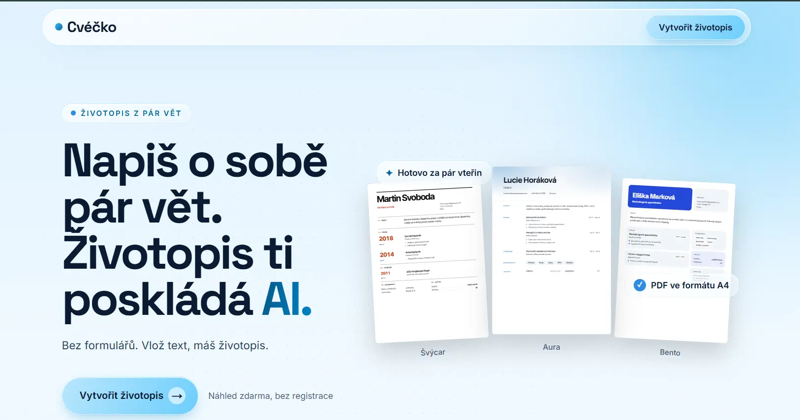

# Cvéčko

Životopis z volného textu. Vložíš pár neučesaných vět o sobě, starý životopis nebo PDF / Word a AI z toho poskládá
hotový životopis v moderní šabloně. Žádný formulář.

**Živě:** https://cvecko.cz · **Autorka:** Věra Paukrtová ([verapaukrtova.cz](https://verapaukrtova.cz) · [GitHub](https://github.com/Veve1211))

---

## Případová studie

### Problém

Klasické generátory životopisů jsou formuláře: desítky políček, do kterých musíš vědět, co napsat. Kdo životopis
dlouho nepsal, se na nich zasekne. Chatboti zase rádi „vylepší“ životopis o zkušenosti, které člověk nemá. Na pohovoru
se to pak vymstí.

### Pro koho

Pro lidi, kterým psaní životopisu nejde nebo ho dlouho nepsali:

- návrat po rodičovské
- absolventi bez praxe
- změna oboru
- kdokoli, kdo má jen chaotické poznámky

Tyhle čtyři situace jsou i jako příklady přímo v aplikaci.

### Jak to vypadá



- jedno textové pole, tlačítko Vytvořit, vpravo živý náhled A4
- 8 vlastních šablon (Aura, Švýcar, Bento, Časopis, Časová osa, Minimal, Blok, Terminál) a 7 barev
- text se upravuje kliknutím přímo v náhledu
- mobile first: na telefonu je ovládání dole na dosah palce
- světle modrý vzhled, česky, přátelský tón

### Z čeho se to skládá

- **životopis z textu nebo souboru** (PDF / DOCX se čte jen v paměti)
- **pojistka proti vymýšlení:** výsledek AI se v kódu, ne přes AI, porovná s původním textem. Firmy, školy, roky,
  čísla, dovednosti, jazyky, kontakty a jména, která v textu nebyla, jsou v náhledu žlutě podtržená. Je tolerantní ke
  skloňování (čeština!) a hlídá i dopis, přizpůsobení inzerátu a angličtinu.
- **motivační dopis** k inzerátu, **přizpůsobení životopisu** inzerátu (AI smí jen měnit pořadí, nic nepřidá ani
  neubere, to vynucuje kód), **anglická verze**
- **PDF A4**, které vypadá stejně jako náhled
- **soukromí:** bez účtů a bez databáze, text se neukládá ani neloguje, životopis žije jen v prohlížeči
- **platby připravené, ale vypnuté:** Stripe Checkout (1 den zdarma / 14 dní / rok) je hotový a otestovaný v test
  mode. Teď je všechno zdarma. Zapnou se až s obnovenou živností. Dokud na stránkách podmínek a reklamací chybí IČO a
  adresa, build se zapnutým Stripe klíčem schválně spadne (`src/lib/legal-check.ts`).

**Stack:** Next.js 16 (App Router), React 19, TypeScript, Tailwind CSS 4, Claude API (`@anthropic-ai/sdk`), zod,
Stripe, headless Chromium na serverové PDF. Hosting Railway.

### Jak to testuju

- **Vitest:** 158 testů logiky (pojistka proti vymýšlení s 10 testovacími vstupy, platby, přístup, PDF, AI s
  mockem)
- **Playwright** na počítači i mobilu: tvorba, šablony, PDF (počet stran a úplnost textu), platby, přístupnost (axe,
  WCAG 2.1 AA), Content-Security-Policy
- **GitHub Actions** u každého PR: lint, typecheck, Vitest, build, Playwright. Merge jen se zeleným CI.
- **hlídač po nasazení:** workflow ověří přímo živý staging, včetně vygenerování PDF v Chromiu
- **Lighthouse (mobil, 23. 11. 2026):** přístupnost, best practices a SEO 100; výkon úvodu 79–84 (dřív 70–74;
  ukázky šablon a jejich písma se načítají až po vykreslení úvodu)
- **ruční kontrola na mobilu** před každým nasazením na ostrý web
- **bezpečnost:** zvlášť v [SECURITY.md](SECURITY.md) (klíče, CSP, rate limit, audit závislostí, kontrola historie)
- **audit:** [docs/audit.md](docs/audit.md), dvě kola s čísly před/po (bezpečnost, náklady na AI, výkon) a co
  se vědomě nedělá

### Moje role

Cvéčko je můj projekt od nápadu po ostrý web. Kód píše AI (Claude Code), já:

- určuju, co se staví a pro koho, a rozhoduju o funkcích, vzhledu i o tom, co v aplikaci nebude
- píšu zadání a pravidla v CLAUDE.md a hlídám, aby je AI dodržovala
- testuju: tři roky jsem pracovala jako testerka softwaru, takže každou změnu proklikám na stagingu na mobilu
  a chyby vracím AI k opravě
- spravuju nasazení (Railway, GitHub) a proměnné prostředí a jako jediná merguju do `main`

### Jak pracuju s AI

Projekt je postavený vibecodingem v Claude Code. AI píše kód, já rozhoduju, co a proč, a kontroluju výsledek.

**Větve:** `dev` = staging, `main` = ostrý web. Každá změna jde přes feature větev a PR do `dev`. Do `main`
merguju jen já, až po kontrole stagingu.

**CLAUDE.md** je pracovní smlouva s AI. Ukázka pravidel:

```markdown
## Pravidla
- Osobní údaje: text uživatele nikde neukládej a nelogguj. Posílá se jen do Claude API.
- AI nesmí přidat zkušenost, firmu, dovednost ani údaj, který v textu není. Smí jen učesat formulace.
- Veškerý text od uživatele/AI vykresluj jako text (React), nikdy `dangerouslySetInnerHTML`.
- Tajné klíče jen v proměnných prostředí. Nikdy v kódu ani commitech.
- Do `main` merguje jen Veve. Nikdy nepushuj ani nemerguj do `main`.
- Nikdy nenechávej v UI placeholder.
```

Každé větší rozhodnutí se zapisuje s datem do [`docs/decisions.md`](docs/decisions.md), takže AI v příští session ví, proč je něco udělané takhle. CLAUDE.md zůstává krátký: jen pravidla a mapa projektu. Proč jsou hlavní věci udělané právě takhle, vysvětluju vlastními slovy v [`docs/proc.md`](docs/proc.md).

### Co jsem se naučila

- **Zelené testy neznamenají funkční web.** PDF na Railway padalo kvůli chybějící systémové knihovně, i když CI
  prošlo. Od té doby hlídám i živý staging.
- **Pojistka patří do kódu, ne do promptu.** Prompt „nevymýšlej si“ nestačí. Spolehlivé je až porovnání výsledku
  s původním textem v kódu.
- **Co jde zapomenout, má hlídat build.** Místo poznámky „před zapnutím plateb doplnit IČO“ teď build sám spadne,
  když je zapnutý Stripe a v podmínkách chybí IČO. Hned první den to zabralo: na produkci jsem klíč smazala, na
  stagingu jsem na něj zapomněla a nasazení se zastavilo. Bez pojistky by staging tiše nabízel platby.
- **Ukázková data se rozlezou.** Vymyšlená Tereza byla na úvodní stránce 15×. Teď je jen tam, kde dává smysl.
- **Pravidla v CLAUDE.md musí jít splnit.** Pravidlo, které AI v daném prostředí splnit nemůže, je horší než žádné.

---

## Pro vývojáře

### Spuštění

```bash
npm install
cp .env.example .env.local   # doplň ANTHROPIC_API_KEY
npm run dev
```

Bez klíče funguje odkaz „Ukázka“ (vymyšlená osoba). Všechny kontroly najednou: `npm run check`.

### Nasazení (Railway)

Build `npm run build`, start `npm start` (port z `PORT`). Proměnné prostředí jsou popsané v `.env.example`.
`railpack.json` přidává do obrazu systémové knihovny (`libnss3`, `libnspr4`, …), které potřebuje headless Chromium.

### Hlídač po nasazení

Workflow **Smoke test staging** (`.github/workflows/smoke.yml`) počká, až `/api/health` hlásí poslední commit z
`dev`, zkontroluje úvodní stránku a s hlavičkou `x-smoke-token` vyrobí testovací PDF z vymyšleného životopisu. Bez
tokenu se Chromium nespustí. Žádná AI, žádná osobní data. Nastavení: `SMOKE_TOKEN` na Railway i v GitHub Secrets,
proměnná `STAGING_URL` na GitHubu.

### Pracovní poznámky

Průběžné zprávy z práce s AI jsou v [`docs/notes/`](docs/notes/).

### Stripe (test mode)

Platby se zapnou proměnnou `STRIPE_SECRET_KEY`. Testovací karta **4242 4242 4242 4242**, libovolné budoucí datum a
CVC. Bez klíče je vše zdarma a o platbách se nic nezobrazuje.
